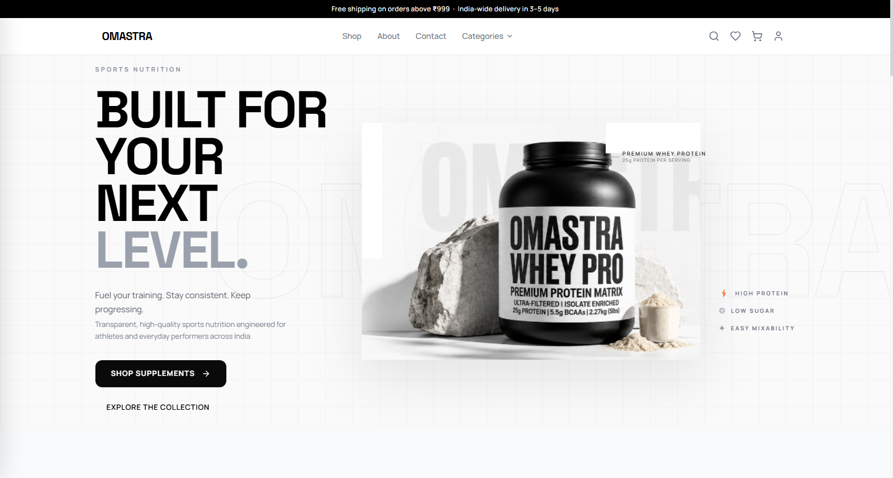
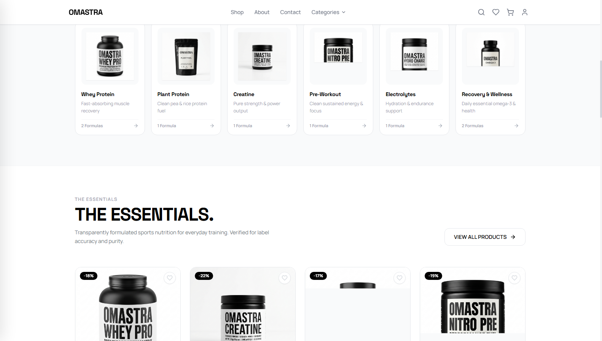
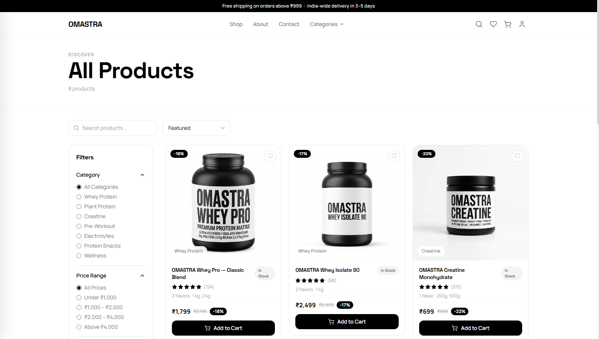
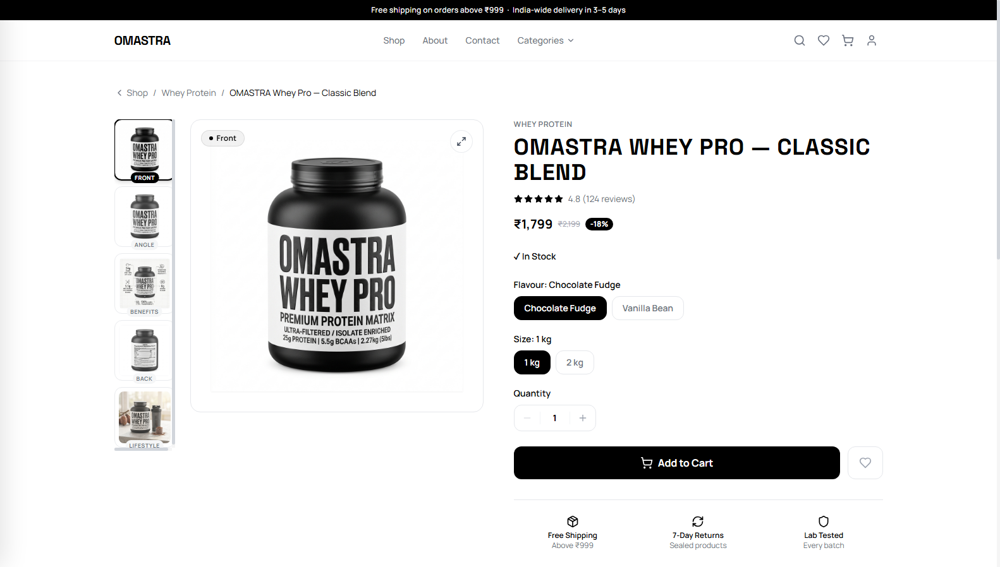
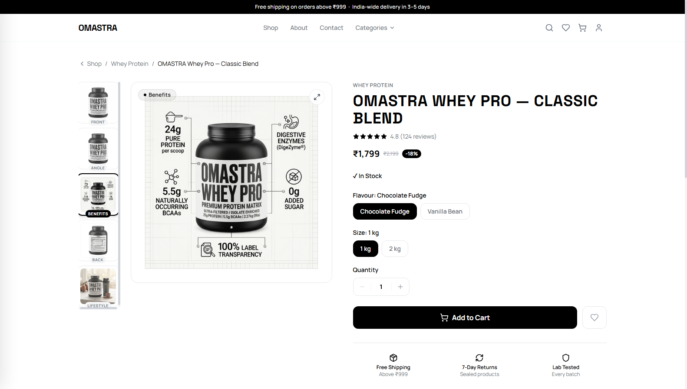
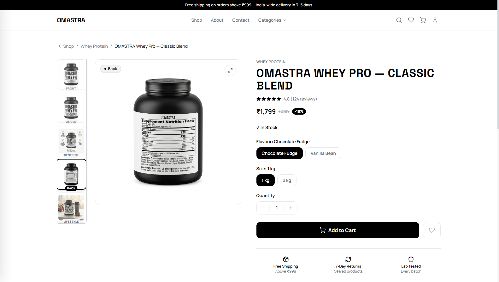
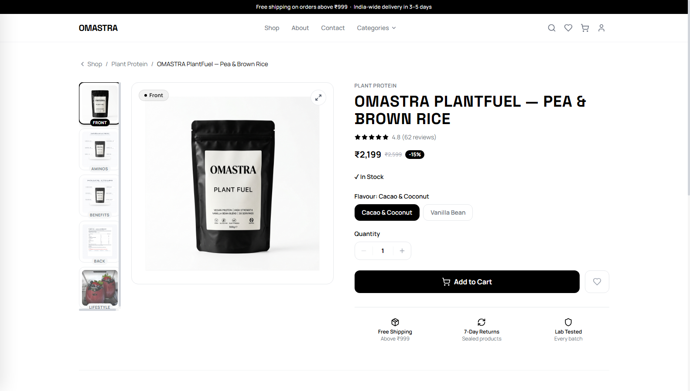
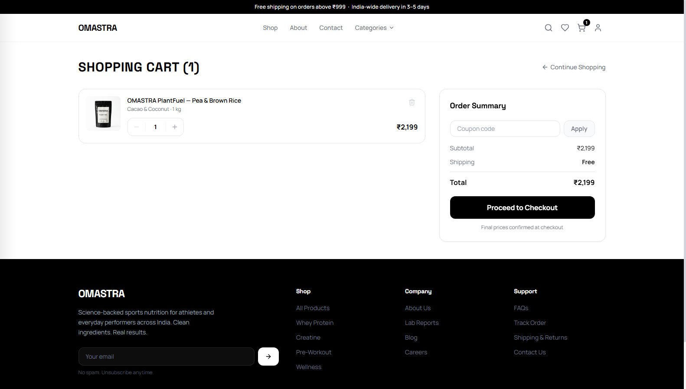
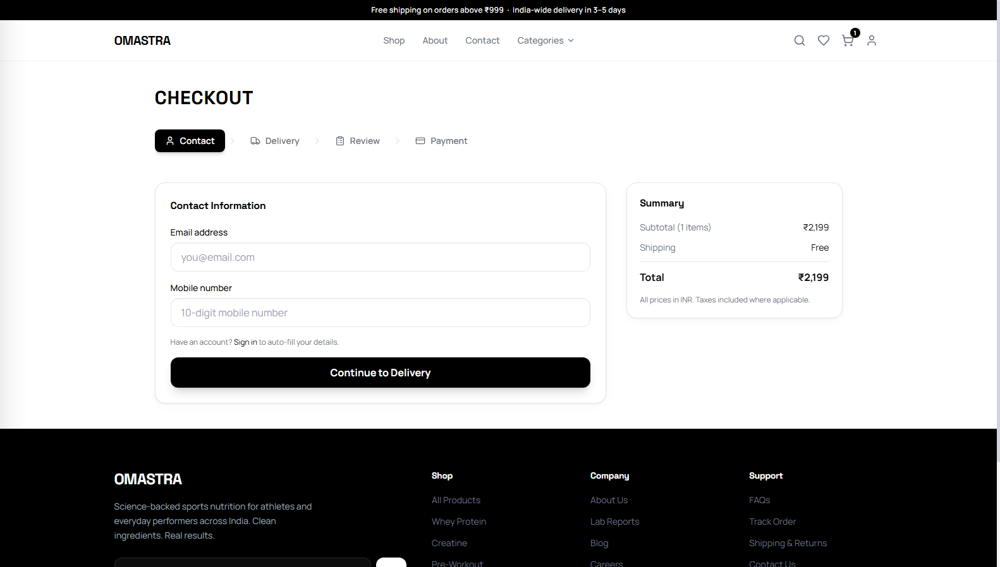
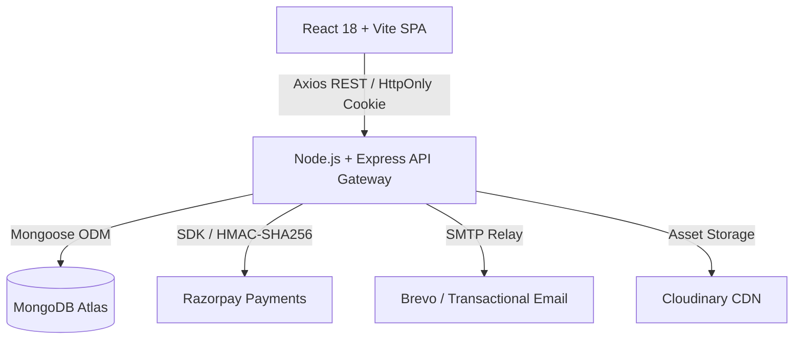

# ⚡ OMASTRA — Sports Nutrition E-Commerce Platform

<div align="center">

[](https://react.dev/)
[](https://vitejs.dev/)
[](https://tailwindcss.com/)
[](https://nodejs.org/)
[](https://expressjs.com/)
[](https://www.mongodb.com/)
[](https://razorpay.com/)

**POWER WITHIN.** — Everyday nutrition. Built for your next level.

*A modern, full-stack Direct-to-Consumer (D2C) sports nutrition e-commerce platform built for high performance, smooth animations, and conversion-optimized purchasing.*

[Live Demo](https://omastra.vercel.app) • [Visual Showcase](#-visual-showcase) • [Key Features](#-key-features) • [Tech Stack](#-tech-stack) • [Quick Start](#-quick-start) • [Admin Panel](#-admin-panel)

---

</div>

## 📸 Visual Showcase

Explore high-resolution screenshots of the OMASTRA platform. All screenshots are archived in the [`screenshots/`](./screenshots/) directory.

### 1. Storefront Experience & Category Discovery

| Homepage Hero Experience | Category Grid ("Find Your Fuel") |
| :---: | :---: |
| [](./screenshots/01-homepage-hero.png) | [](./screenshots/02-categories-showcase.png) |
| *Hero section with CTA, trusted stats, and flagship Whey Pro spotlight.* | *Interactive visual category navigator with category filters.* |

---

### 2. Product Catalog & Advanced Filtering

| Filterable Shop Catalog | Responsive Grid View |
| :---: | :---: |
| [](./screenshots/03-shop-catalog.png) | [](./screenshots/03-shop-catalog.png) |
| *Multi-facet filtering: Category, Price, Dietary Badges, Ratings, and Sorting.* | *Real-time discount badges, stock levels, and instant Add-to-Cart triggers.* |

---

### 3. Amazon-Grade Multi-Angle Product Gallery

OMASTRA features an interactive 5-thumbnail image gallery replicating industry-leading D2C supplement storefronts:

| Front View & Variant Selection | Infographic & Benefits Breakdown |
| :---: | :---: |
| [](./screenshots/04-product-details-gallery.png) | [](./screenshots/05-product-infographic-view.png) |
| *High-res primary jar render with flavor/size selectors and authenticity seal.* | *Informational banner breaking down protein ratio, BCAAs, and EAAs.* |

| Supplement Facts & Nutrition Panel | Plant-Based Category Spotlight |
| :---: | :---: |
| [](./screenshots/06-product-back-panel-view.png) | [](./screenshots/07-plantfuel-product-page.png) |
| *Clear, high-legibility back panel displaying ingredients and macros.* | *PlantFuel 100% Organic Pea & Brown Rice Protein pouch display.* |

---

### 4. Conversion Funnel: Cart & Checkout

| Shopping Cart & Order Summary | Multi-Step Frictionless Checkout |
| :---: | :---: |
| [](./screenshots/08-cart-page.png) | [](./screenshots/09-checkout-page.png) |
| *Cart drawer/page with live quantity adjustments, coupon validation, and totals.* | *Multi-step checkout: Contact details, Shipping Address, and Payment method.* |

---

## ⚡ Key Features

### 🛒 Customer Storefront
- **Dynamic Catalogue**: Filter by category, price range, dietary preference (Vegan, Gluten-Free, Keto), flavor, and ratings.
- **5-Angle Interactive Product Gallery**:
  - `Angle 01`: Premium Front Product Render
  - `Angle 02`: 45-Degree Perspective View
  - `Angle 03`: Detailed Supplement Facts / Back Nutrition Label
  - `Angle 04`: Infographic & Key Benefits Highlight
  - `Angle 05`: Lifestyle / In-Action Fitness Context
- **Variant Engine**: Dynamic switching between flavors (Double Rich Chocolate, Belgian Chocolate, Alphonso Mango, Unflavoured) and pack sizes (1kg, 2kg, 4kg).
- **Persistent Cart & Wishlist**: Real-time synchronization supporting both guest checkout and logged-in profiles.
- **Coupon System**: Live promo code engine supporting percentage-based and flat-rate discounts with minimum order thresholds.
- **Dual Payment Options**:
  - **Cash on Delivery (COD)** with automated order verification.
  - **Razorpay Payment Gateway** supporting UPI, Net Banking, Debit/Credit Cards, and Wallets with cryptographic server-side HMAC-SHA256 signature verification.

### 🛡️ Admin Command Center (`/admin`)
- **Executive KPI Dashboard**: Live revenue, order volumes, average order value (AOV), and customer growth charts powered by **Recharts**.
- **Product & Inventory Management**: Full CRUD operations, variant stock tracking, threshold alert badges, and multi-image URL uploads.
- **Order Fulfilment**: Status pipeline (`Pending` → `Processing` → `Shipped` → `Delivered` → `Cancelled`) with order audit logs.
- **Promotions & Coupon Manager**: Create and manage promo codes with usage limits, expiry timestamps, and tier thresholds.
- **Customer Directory**: View customer profiles, order history, and account activity.
- **Review Moderation**: Filter, approve, reject, and monitor verified buyer reviews.

### 🔒 Enterprise Security
- **JWT Authentication**: Secure HttpOnly cookie architecture with 15-minute access token rotation and 7-day refresh tokens.
- **Role-Based Access Control (RBAC)**: Enforced strictly at the API controller layer (`requireAdmin`, `protect`).
- **Cryptographic Security**: Passwords hashed with `bcryptjs` (salt factor 12); Razorpay payment signatures verified with HMAC-SHA256.
- **Defensive Middleware**: Protection via `helmet`, strict CORS whitelist, Mongo sanitize, and sliding-window rate limiting.

---

## 🛠️ Tech Stack



| Layer | Technologies |
| :--- | :--- |
| **Frontend Framework** | [React 18](https://react.dev/), [Vite 5](https://vitejs.dev/) |
| **Styling & Design** | [Tailwind CSS 3.4](https://tailwindcss.com/), [Lucide React](https://lucide.dev/), Headless UI |
| **Data Fetching & State** | [TanStack React Query](https://tanstack.com/query/latest), React Context API |
| **Routing & Navigation** | [React Router v6](https://reactrouter.com/) |
| **Data Visualization** | [Recharts](https://recharts.org/) |
| **Backend Server** | [Node.js](https://nodejs.org/), [Express 4](https://expressjs.com/) |
| **Database & ODM** | [MongoDB](https://www.mongodb.com/), [Mongoose](https://mongoosejs.com/) |
| **Authentication** | JSON Web Tokens (`jsonwebtoken`), `bcryptjs`, Cookie-Parser |
| **Payment Gateway** | [Razorpay SDK](https://razorpay.com/) (Test & Live Mode) |
| **Transactional Email** | [Nodemailer](https://nodemailer.com/), Brevo SMTP Relay |

---

## 📂 Project Structure

```bash
omastra/
├── screenshots/               # High-res screenshots of the live platform
│   ├── 01-homepage-hero.png
│   ├── 02-categories-showcase.png
│   ├── 03-shop-catalog.png
│   ├── 04-product-details-gallery.png
│   ├── 05-product-infographic-view.png
│   ├── 06-product-back-panel-view.png
│   ├── 07-plantfuel-product-page.png
│   ├── 08-cart-page.png
│   └── 09-checkout-page.png
├── client/                    # React + Vite frontend
│   ├── public/                # Static assets & favicon
│   ├── src/
│   │   ├── components/        # UI components (Header, Footer, Gallery, Modals)
│   │   ├── context/           # AuthContext, CartContext, WishlistContext
│   │   ├── hooks/             # Custom utility hooks
│   │   ├── lib/               # Axios client configuration & helpers
│   │   ├── pages/             # Page components
│   │   │   ├── admin/         # Admin dashboard & management views
│   │   │   ├── auth/          # Login, Register, Password Reset
│   │   │   ├── checkout/      # Multi-step checkout flow
│   │   │   ├── home/          # Hero, category cards, featured products
│   │   │   └── shop/          # Catalog & product detail with 5-image gallery
│   │   ├── routes/            # AppRouter & ProtectedRoute wrapper
│   │   └── services/          # API service endpoints
│   ├── package.json
│   └── vite.config.js
├── server/                    # Node.js + Express backend
│   ├── src/
│   │   ├── config/            # Database connection & third-party configs
│   │   ├── controllers/       # Controller handlers (Auth, Product, Order, etc.)
│   │   ├── middleware/        # Auth verification, error handling, rate limiting
│   │   ├── models/            # Mongoose Schemas (User, Product, Order, Coupon)
│   │   ├── routes/            # REST API endpoints
│   │   ├── seeds/             # Database seeder scripts
│   │   ├── services/          # Email & third-party integrations
│   │   └── server.js          # Express app entry point
│   ├── package.json
│   └── .env.example
└── README.md                  # Project documentation
```

---

## 🚀 Quick Start

### 1. Prerequisites
- **Node.js** >= 18.0.0
- **MongoDB** (Local instance or [MongoDB Atlas](https://www.mongodb.com/atlas))
- **npm** or **yarn**

### 2. Clone and Install Dependencies

```bash
# Clone the repository
git clone https://github.com/TanujGupta21/omastra.git
cd omastra

# Install Backend dependencies
cd server
npm install

# Install Frontend dependencies
cd ../client
npm install
```

---

## ⚙️ Environment Variables

### Backend Configuration (`server/.env`)
Create a `.env` file in the `server` directory:

```env
PORT=5000
NODE_ENV=development
CLIENT_URL=http://localhost:5173

# Database
MONGO_URI=mongodb://localhost:27017/omastra

# Authentication (JWT)
JWT_ACCESS_SECRET=your_super_secret_access_key_min_32_chars
JWT_REFRESH_SECRET=your_super_secret_refresh_key_min_32_chars
JWT_ACCESS_EXPIRE=15m
JWT_REFRESH_EXPIRE=7d

# Payment Gateway (Razorpay)
RAZORPAY_KEY_ID=rzp_test_your_key_id
RAZORPAY_KEY_SECRET=your_razorpay_secret

# Image Management (Cloudinary)
CLOUDINARY_CLOUD_NAME=your_cloud_name
CLOUDINARY_API_KEY=your_api_key
CLOUDINARY_API_SECRET=your_api_secret

# Transactional Email (SMTP / Brevo)
SMTP_HOST=smtp-relay.brevo.com
SMTP_PORT=587
SMTP_USER=your_smtp_user
SMTP_PASS=your_smtp_password
EMAIL_FROM=support@omastra.com

# Demo Seeding Credentials
ADMIN_EMAIL=admin@omastra.com
ADMIN_PASSWORD=AdminStrongPassword123!
```

### Frontend Configuration (`client/.env`)
Create a `.env` file in the `client` directory:

```env
VITE_RAZORPAY_KEY_ID=rzp_test_your_key_id
```

---

## 🏃 Running in Development

Run both the server and client dev servers:

```bash
# Terminal 1: Backend API (runs on http://localhost:5000)
cd server
npm run dev

# Terminal 2: Frontend Vite App (runs on http://localhost:5173)
cd client
npm run dev
```

The Vite dev server automatically proxies API requests to `http://localhost:5000/api`.

---

## 📦 Seeding Demo Data

Seed your MongoDB database with realistic categories, product catalog with multi-image gallery sets, promo coupons, and an administrator account:

```bash
cd server
npm run seed
```

This populates:
- **Admin Account**: Email & Password configured in `server/.env`
- **7 Product Categories**: Whey Protein, Plant Protein, Creatine, Pre-Workout, Hydration, BCAAs, Multivitamins
- **15+ High-Performance Products** complete with pricing, stock variants, ingredients, and nutrition facts
- **Active Promotional Coupons**: `OMASTRA10`, `WELCOME15`, `SAVE200`

---

## 🔐 Admin Panel Access

1. Navigate to `http://localhost:5173/auth/login`
2. Sign in with your seeded administrator credentials (`ADMIN_EMAIL` / `ADMIN_PASSWORD`)
3. Access the dashboard at `http://localhost:5173/admin`

> **Note:** Administrative privileges are strictly enforced on all server routes using the `requireAdmin` middleware. Unauthorized API calls receive `403 Forbidden`.

---

## 💳 Payment Gateway Setup

### Cash on Delivery (COD)
COD is enabled out of the box with zero third-party setup required.

### Razorpay Integration (Test Mode)
1. Sign up for a free merchant account at [Razorpay](https://razorpay.com).
2. Generate your **Test Key ID** and **Test Key Secret** from Dashboard → **Settings** → **API Keys**.
3. Add the keys to `server/.env` and `client/.env`.
4. Test using standard test card credentials provided in the [Razorpay Docs](https://razorpay.com/docs/payments/payments/test-card-upi-details/).

---

## 📡 REST API Reference

All API routes are prefixed under `/api/v1/`:

| Endpoint | Method | Access | Description |
| :--- | :---: | :---: | :--- |
| `/api/v1/auth/register` | `POST` | Public | Register new user account |
| `/api/v1/auth/login` | `POST` | Public | Authenticate user & issue HttpOnly JWT |
| `/api/v1/auth/logout` | `POST` | Public | Clear auth cookies |
| `/api/v1/auth/me` | `GET` | User | Get current user profile |
| `/api/v1/products` | `GET` | Public | List products with search, filters & pagination |
| `/api/v1/products/:id` | `GET` | Public | Get single product with full gallery & variants |
| `/api/v1/products` | `POST` | Admin | Create new product |
| `/api/v1/cart` | `GET` | User/Guest | Retrieve current cart items |
| `/api/v1/cart/items` | `POST` | User/Guest | Add item to cart |
| `/api/v1/orders` | `POST` | User | Create a new order (COD or Razorpay) |
| `/api/v1/payments/verify` | `POST` | User | Verify Razorpay payment signature |
| `/api/v1/coupons/apply` | `POST` | User | Validate and apply promo coupon |
| `/api/v1/admin/dashboard` | `GET` | Admin | Fetch analytics, revenue charts & KPI counters |

---

## 📄 License & Attribution

Distributed under the **MIT License**. See `LICENSE` for more information.

Developed with passion for fitness and modern web engineering.

---

<div align="center">
  <sub>Built with ❤️ by Tanuj Gupta • Powered by OMASTRA</sub>
</div>
